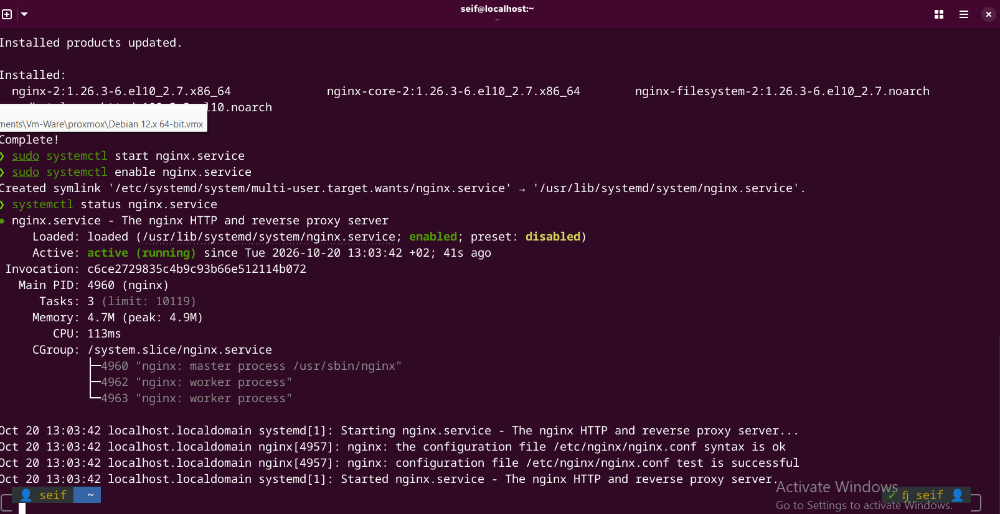
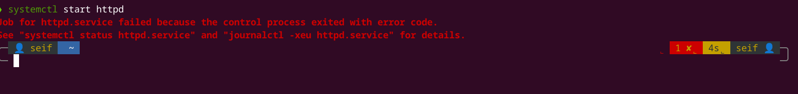
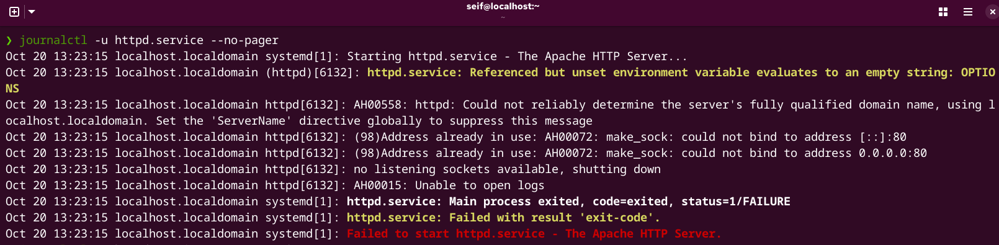
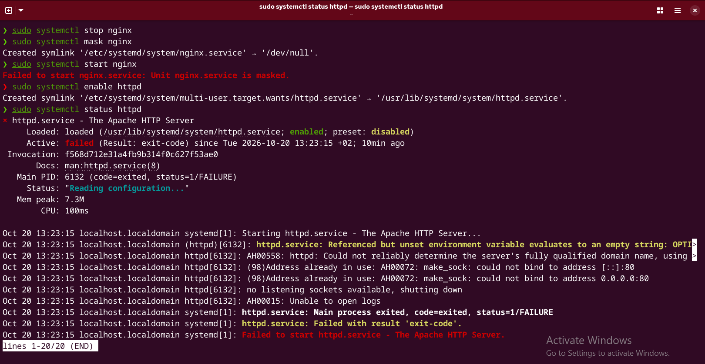
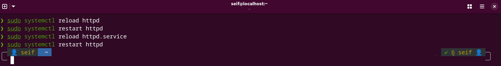
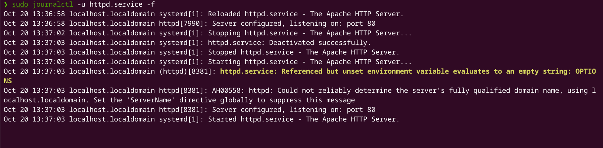
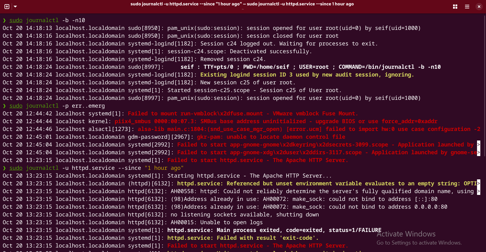
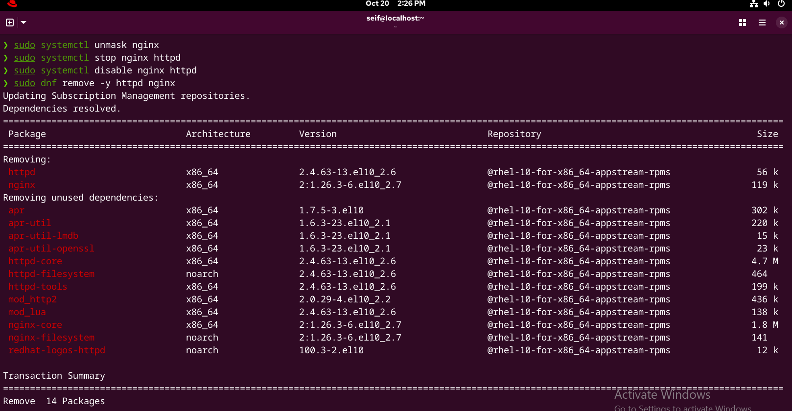

  GNU nano 8.1                                                     Lab05/README.md                                                               
# RedHat-Linux-Labs

## Lab 06 - Control Service & Logging Operation

### Part 1: Package Discovery & Initial Service Setup

1- Open Manual Page: Open the manual page for the primary package manager command on RHEL (dnf) `man dnf`

2- Install nginx: Install the nginx web server package using dnf `sudo dnf install -y nginx`

3- Start and Enable nginx: Start and enable the nginx service `sudo systemctl enable --now nginx`

4- Verification: Verify and confirm that nginx is active and enabled `sudo systemctl status nginx`

-------------------------------------------------------------------------------------------------------

### Part 2: Port Conflict Analysis & Service Masking

1- Install httpd: Install the Apache HTTP Server package `sudo dnf install -y httpd`

2- Attempt to Start httpd: Attempt to start httpd while nginx is actively running `sudo systemctl start httpd`

----------------------------------------------------------------------------------------------------------
Exercise 2.2: Log Inspection & Root Cause Analysis 

1. Use journalctl to inspect the recent logs generated specifically by the httpd unit.`sudo journalctl -u httpd.service --no-pager`

 
2. Review the log output to locate the error message.

-----------------------------------------------------------------------------------------------------------

Exercise 2.3: Service Masking & Failover 

1. Stop the running nginx service.`sudo systemctl stop nginx`
 
2. Mask the nginx service unit to prevent any user or automated script from starting it. `sudo systemctl mask nginx`
 
3. Test your mask configuration by explicitly attempting to start nginx. `sudo systemctl start nginx`
 
5. Start and enable the httpd service now that nginx is masked and stopped. `sudo systemctl enable httpd`

6. Verify that httpd is currently active (running).`sudo systemctl status httpd`

-----------------------------------------------------------------------------------------------------------------

Exercise 2.4: Service Lifecycle Operations:
 
1. Reload the configuration of the active httpd service without interrupting running processes. `sudo systemctl reload httpd`

2. Perform a full restart of the httpd service.`sudo systemctl restart httpd`

--------------------------------------------------------------------------------------------------------------------

##  Part 3: Advanced Logging with journalctl

Exercise 3.1: Live Log Streaming 

1. Run a journalctl command to stream and follow the logs of the httpd service in real time.`sudo journalctl -u httpd.service -f`

 
----------------------------------------------------------------------------------------------------------------------

Exercise 3.2: Log Filtering by Boot, Severity, and Time 

1. Display system logs generated during the current boot session only. `sudo journalctl -b`

2. Execute a journalctl query that filters system logs to display only messages with severity levels 
ranging from Error to Emergency (err to emerg). `sudo journalctl -p err..emerg`

3. Display the logs for the httpd service generated within the last 1 hour. `sudo journalctl -u httpd.service --since "1 hour ago"`

--------------------------------------------------------------------------------------------------------------------------

## Part 4: Environment Cleanup 

Exercise 4.1: System Restoration 

1. Unmask the nginx service.`sudo systemctl unmask nginx` 

2. Stop both httpd and nginx services. `sudo systemctl stop httpd nginx`

3. Disable both httpd and nginx from starting at system boot. `sudo systemctl disable httpd nginx`

4. Remove both httpd and nginx packages from the system using dnf.`sudo dnf remove -y httpd nginx` 

----------------------------------------------------------------------------------------------------------------------
