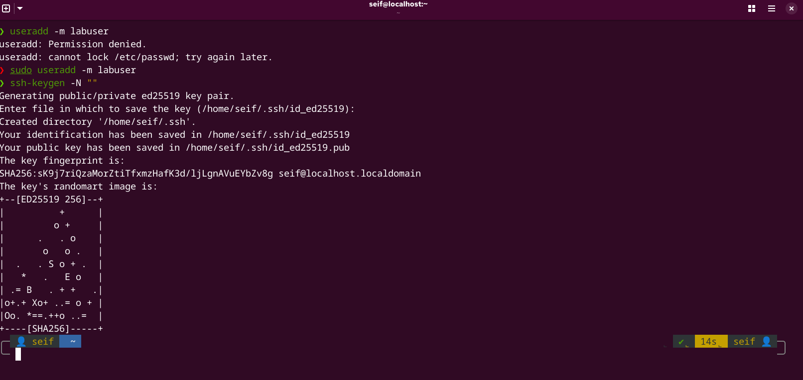
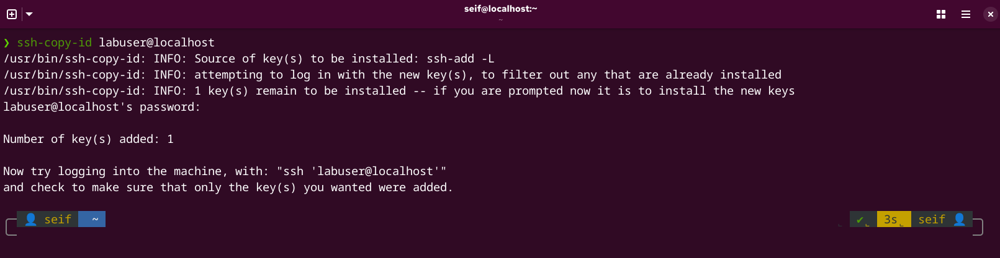
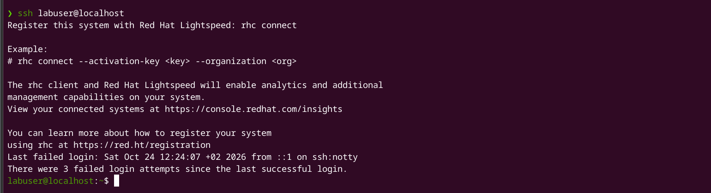

### Part 1: Process Signals & State Transitions

1- Start Background Process `sleep infinity &`
2- Identify Process ID `pgrep sleep` `pidof sleep`
3- Suspend Process (SIGSTOP) `kill -19 <PID>`
4- Resume Process (SIGCONT) `kill -18 <PID>`
5- Terminate Process `kill -9 <PID>`

----------------------------------------------------------------------------------------------------

### Part 2: SSH (Key-Based Authentication)

6- Create User `sudo useradd -m labuser`
7- Generate SSH Key `ssh-keygen -N ""`

8- Copy Public Key `ssh-copy-id labuser@localhost`

9- Verify SSH Login `ssh labuser@localhost`

-------------------------------------------------------------------------------------------------------
