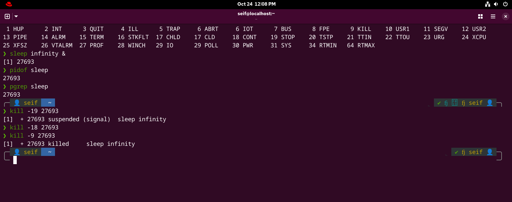

# RedHat-Linux-Labs

## Lab 07 - Linux Process Control and SSH

### Part 1: Process Signals & State Transitions

1- Start Background Process: Run a process that remains active indefinitely in the background `sleep infinity &`

2- Identify Process ID: Determine the PID of the running sleep infinity process `pgrep sleep` & `pidof sleep`

3- Suspend Process (SIGSTOP): Pause the process using Signal 19 and verify state code T `kill -19 <PID>`

4- Resume Process (SIGCONT): Wake the process using Signal 18 and verify state changes back to S `kill -18 <PID>`

5- Terminate Process: Kill the process immediately using Signal 9 `kill -9 <PID>`

---------------------------------------------------------------------------------------------------------------------

### Part 2: SSH (Key-Based Authentication)

6- Create User: Create a new user named labuser with a home directory `sudo useradd -m labuser`

7- Generate SSH Key: Generate an SSH key pair for your current user without a passphrase `ssh-keygen -N ""`

8- Copy Public Key: Copy the generated public key to labuser on the local machine `ssh-copy-id labuser@localhost`

9- Verify SSH Login: Log into labuser via SSH without being prompted for a password `ssh labuser@localhost`

---------------------------------------------------------------------------------------------------------------------------
